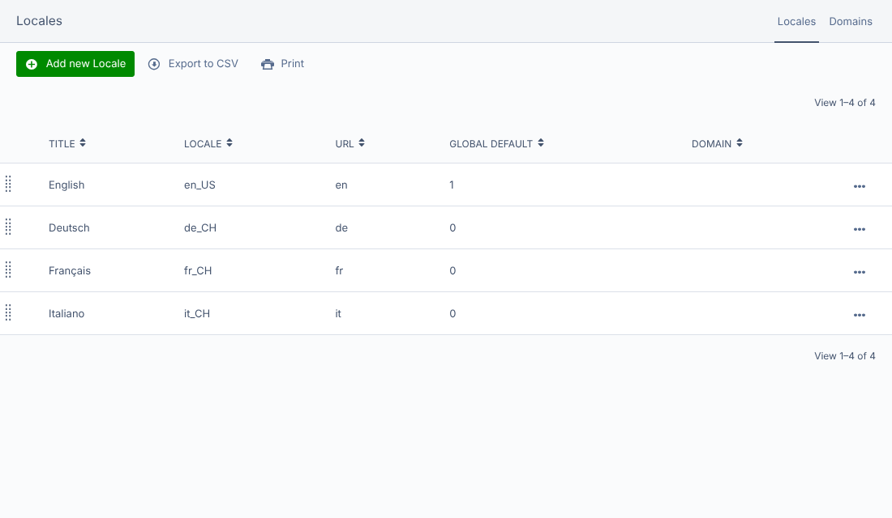
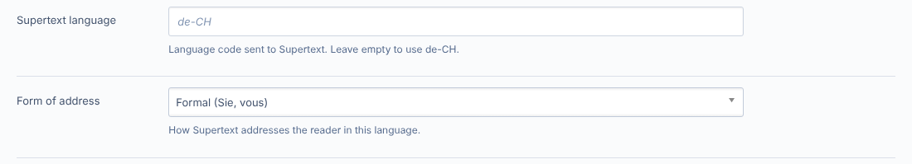

# Installation guide — Supertext Translation for Silverstripe

For administrators and developers who install and set up the module. Editors find their part in the [user guide](USER_GUIDE.md).

## Requirements

- Silverstripe CMS 6 (tested with 6.2), PHP 8.3 or later
- [Fluent](https://github.com/tractorcow-farm/silverstripe-fluent) 8 with at least two locales
- Optional: [Elemental](https://github.com/silverstripe/silverstripe-elemental) 6, with blocks localised directly by Fluent (see [Elemental blocks](#elemental-blocks))
- A Supertext account with an API key: [create an account or log in](https://www.supertext.com/person/en/account/signin), then [generate the key](https://www.supertext.com/en/integrations/api) (see [API key](#api-key))
- The server must reach `https://api.supertext.com` over HTTPS

## Install

```bash
composer config repositories.supertext vcs https://github.com/Supertext/Silverstripe-Supertext-Translation
composer require supertext/silverstripe-supertext-translation:dev-main
vendor/bin/sake db:build --flush
```

(Publishing to Packagist is planned; then the first line is no longer needed.)

`db:build` adds the tables `SupertextTranslation` (the translation log) and `SupertextState` (the module's own state, see [Version information and the API key check](#version-information-and-the-api-key-check)) and two fields to Fluent's locales. The module adds:

- a **Supertext** tab to every page in the CMS (for users with the Supertext permission),
- a **Supertext** section in the CMS menu: connection status, the latest API key check, the installed plugin version, *Test connection* (administrators), whether version information is sent to Supertext, the locales and the translation log,
- *Supertext language* and *Form of address* to each locale under **Locales**,
- the public route `/supertext/ping` (see [The ping endpoint](#the-ping-endpoint)),
- the tasks `supertext-translate` and `supertext-check`.

### Update

```bash
composer update supertext/silverstripe-supertext-translation
vendor/bin/sake db:build --flush
```

See [CHANGELOG.md](../CHANGELOG.md). The installed version is shown under **Supertext → Connection → Plugin version** (as Composer installed it: a release such as `0.1.0`, linked to its release notes on GitHub, or a branch such as `dev-main`; `unknown` if Composer's data isn't available).

### Uninstall

```bash
composer remove supertext/silverstripe-supertext-translation
vendor/bin/sake db:build --flush
```

Translations already made are normal Fluent content and stay. The tables `SupertextTranslation` and `SupertextState` and the columns `SupertextCode` and `SupertextPoliteness` of `Fluent_Locale` are left in the database (Silverstripe never drops them); delete them by hand if you like.

## API key

1. **Supertext account.** No Supertext account yet? [Log in or create a Supertext account](https://www.supertext.com/person/en/account/signin) with your e-mail address.
2. **Generate the key** at [supertext.com → Integrations → API](https://www.supertext.com/en/integrations/api). This requires the **Admin** role in your Supertext account; ask your Supertext account's administrator otherwise.

The **Supertext** section in the CMS shows these two links under *Connection*, and `vendor/bin/sake tasks:supertext-check` prints them when no key is set.

Set the key as an environment variable, in `.env` or in your hosting's settings:

```bash
SUPERTEXT_API_KEY="your-key"
```

You can paste it with or without the `Supertext-Auth-Key ` prefix that Supertext shows. The module sends it as `Authorization: Supertext-Auth-Key <key>`. Keep the key out of your repository.

Check it under **Supertext → Test connection** (administrators) or with `vendor/bin/sake tasks:supertext-check`. Both call a cost-free endpoint of the Supertext API. The module also checks the key by itself when it changes (see [the API key check](#version-information-and-the-api-key-check)); the Supertext section shows the latest result with its time under *API key check*.


## Locales

The module translates between your Fluent locales (**Locales** in the CMS menu). Each locale has a **Supertext language** (a combo box on the locale), and Supertext accepts exactly these codes (its own language list, October 2026):

| Language | Supertext codes |
| --- | --- |
| German, English, French, Italian, Portuguese | `de-DE`, `de-CH`, `de-AT`, `en-US`, `en-GB`, `fr-FR`, `fr-CH`, `it-IT`, `it-CH`, `pt-PT`, `pt-BR` |
| Chinese, Serbian | `zh-Hans`, `zh-Hant`, `sr-Latn`, `sr-Cyrl` |
| Swiss German | `gsw-u-sd-chzh` (Zurich), `gsw-u-sd-chbe` (Bern) |
| All others, without region | `bg`, `cs`, `da`, `el`, `es`, `fi`, `hr`, `hu`, `ja`, `ko`, `nb`, `nl`, `pl`, `rm`, `ru`, `sk`, `sl`, `sq`, `sv`, `tr` |

Which code a locale uses:

1. The locale's **Supertext language**, if you chose one.
2. Else the code that **is** the locale (apart from upper/lower case and `_`/`-`): `de_CH` → `de-CH`, `fr_CH` → `fr-CH`, `en_US` → `en-US`, `nl` → `nl`.
3. Else the **default**, where it is obvious:

   | Locale | Default |
   | --- | --- |
   | `de`, `en`, `fr`, `it`, `pt` | `de-DE`, `en-US`, `fr-FR`, `it-IT`, `pt-PT` |
   | `zh`, `zh_CN`, `zh_SG` / `zh_TW`, `zh_HK`, `zh_MO` | `zh-Hans` / `zh-Hant` |
   | `sr`, `sr_Latn_RS` / `sr_Cyrl_RS` | `sr-Latn` / `sr-Cyrl` |
   | a region of a language Supertext has without region | that language: `es_ES`, `es_419` → `es`, `nl_NL` → `nl`, `nb_NO` → `nb`, `sl_SI` → `sl` |

4. Else the locale **has no Supertext language** and can't be translated into or from until you choose one: no region is guessed, so `en_IE`, `de_LI`, `fr_BE`, `sr_RS`, `gsw` and `no` need one. The Supertext tab shows such a locale greyed out with *No Supertext language*, and the Supertext section marks it *Not mapped*.
- As the source, the locale is sent without region (`en_US` → `en`, `de_CH` → `de`); the same Supertext language serves both directions.
- Use regional locales where they matter: `de-CH` writes "ss" instead of "ß".



Open a locale to set its two Supertext fields:

- **Supertext language**: a combo box with every Supertext language, by name (in your CMS interface language) and code, e.g. *German (Switzerland) (de-CH)*. The first entry, *Default: German (Germany) (de-DE)*, is the suggestion from the list above and is what an unchanged locale uses; it reads *— choose —* when the locale has no default. Choose another entry to use a different variant (e.g. `de` → *German (Switzerland)*). Only Supertext's codes can be saved. A code set before (e.g. by an older version of the module) that isn't in the list stays selectable and is sent as it is.
- **Form of address**: *Formal (Sie, vous)*, *Informal (du, tu)* or *Default*. Shown only for Supertext languages that offer it (not for English, Swiss German, Romansh, Albanian and Serbian; after changing the Supertext language, save to see it). If one was set before for such a language, the field stays, says so, the Supertext section shows a warning, and translations into that locale fail with *Supertext offers no formal or informal tone for this language* until you set it back to *Default*.

**Updating from an older version:** run `sake db:build`. Supertext languages already set stay as they are; codes saved in another spelling (`de_ch`) are rewritten in Supertext's (`de-CH`), so the combo box shows them. Locales that had none now use the default from the list above.



## Permissions

Under **Security → Groups → Permissions**, give editors:

- **Translate content with Supertext** (`SUPERTEXT_TRANSLATE`, category *Supertext*): shows the Supertext tab and the Supertext section.
- Access to **Pages** and the right to edit the pages, as usual.

The module checks that the user may edit the page **in each target locale**. If you restrict groups to certain locales with Fluent's *Access "Deutsch" (de_CH)* permissions, editors can only translate into the locales their groups cover. *Test connection* is for administrators.

## Settings

All settings are optional and live in YAML:

```yaml
Supertext\Silverstripe\Supertext:
  environment: live          # live | staging | testing
  api_url: ''                # a different base URL; SUPERTEXT_API_URL wins
  timeout: 180               # seconds to wait for one locale
  version_reports: true      # "Send version information to Supertext"; SUPERTEXT_VERSION_REPORTS wins

Supertext\Silverstripe\Service\Translator:
  exclude_fields:            # localised fields that are never translated (merged with the defaults)
    - MyColourCode
```

| Setting | Default | Description |
| --- | --- | --- |
| `SUPERTEXT_API_KEY` (environment) | – | The Supertext API key. |
| `SUPERTEXT_API_URL` (environment) | – | A different base URL (proxy, test server). Wins over `api_url`. |
| `Supertext.environment` | `live` | `live` (`https://api.supertext.com/v1/`), `staging` or `testing`. |
| `Supertext.api_url` | – | A different base URL. |
| `Supertext.timeout` | `180` | Seconds to wait for the translation of one locale. |
| `Supertext.poll_interval` | `2` | Seconds between status checks. |
| `Supertext.version_reports` | `true` | *Send version information to Supertext* (see [below](#version-information-and-the-api-key-check)). `false` turns it off. |
| `SUPERTEXT_VERSION_REPORTS` (environment) | – | Wins over `version_reports`: `0` (or `false`, `off`, `no`) turns version reports off, `1` (`true`, `on`, `yes`) on. |
| `Translator.exclude_fields` | `URLSegment`, `ExtraMeta`, `ReportClass`, `ExtraClass`, `Style` | Localised fields that are never translated. |
| `Translator.max_depth` | `5` | How deep owned objects (area → blocks → nested blocks) are followed. |
| `<YourClass>.supertext_exclude_fields` | – | Per class: more fields not to translate. |
| Locale → *Supertext language* | *Default*: the Supertext code equal to the locale, else the default (`de` → `de-DE`, `es_ES` → `es`) | The language mapping, a combo box of Supertext's codes: the Supertext code for that locale, as target and (without region) as source. Needed for locales without a default (`en_IE`, `gsw`). |
| Locale → *Form of address* | Default | Formal or informal tone for that locale. |

### What is translated

Every field that **Fluent localises** and that holds text: `Varchar`, `Text`, `HTMLText` and `HTMLVarchar` (Fluent's defaults), so the same rules (`translate`, `field_include`, `field_exclude`, `data_include`) decide. HTML fields are translated as HTML. The URL segment is made from the translated title when a locale is created. Fields that hold codes rather than words should be excluded with `exclude_fields` or `supertext_exclude_fields`.

### Elemental blocks

Blocks are translated when they are localised **directly**: add Fluent to the blocks, and keep one block area per page.

```yaml
DNADesign\Elemental\Models\BaseElement:
  extensions:
    - TractorCow\Fluent\Extension\FluentVersionedExtension
```

The module follows the objects a page *owns* (Silverstripe's `owns`), so blocks, nested blocks and other owned, localised objects are translated with the page. The *indirect* setup (a separate block area per locale) is not supported yet.

## Version information and the API key check

**Send version information to Supertext** is on by default (`version_reports: true`). Label and help text in the Supertext section: *Sends the site URL and the versions of this plugin, the CMS and the runtime to Supertext after an update and when the API key changes, so Supertext support can see which version you run. No content, no API key and no personal data are sent.*

A report contains exactly: the site URL (Silverstripe's base URL: `SS_BASE_URL`, else the address of the request), the module's name (`Silverstripe-Supertext-Translation`) and version, the Silverstripe CMS and PHP versions, the Supertext SDK version, whether an API key is set, the result of the API key check below (status, time, HTTP status, Supertext's error code) and the address of the ping endpoint. **No content, no API key and no personal data are sent.** Reports go from the web server to Supertext, never from the editor's browser: the first time the module runs in the CMS, after an update of the module, Silverstripe or PHP, when the result of the key check changes, and from the `supertext-check` task. They are sent after the CMS has answered the request, wait at most 3 seconds, and a report that fails is not tried again for an hour; nothing about them can slow down or break a translation.

To turn it off, set `version_reports: false` in your YAML configuration (and `?flush`) or the environment variable `SUPERTEXT_VERSION_REPORTS=0`. Nothing is sent at all then, and the ping endpoint answers 404. The Supertext section shows whether it is on.

**The API key check** runs whether or not version information is sent: on back-end requests that run the module (the Supertext section, a translation) when the key in `SUPERTEXT_API_KEY` is new or changed (compared by a fingerprint stored in the database, never the key itself), on **Test connection**, in the `supertext-check` task, and when Supertext rejects the key during a translation. It's Supertext's cost-free `features` call; nothing is translated or billed. Silverstripe keeps the key in the environment and the settings in YAML, so there is no settings form to check it on save. The Supertext section shows the latest result with its time: *the connection works*, *Supertext rejected the API key* and *no API key is set* (both with the links to create an account and generate a key), *Supertext can't be reached*, or *Supertext answered with an error*.

The module keeps this state (what was reported last, the latest key check) in the table `SupertextState`.

### The ping endpoint

`GET <site>/supertext/ping?challenge=…` is public (no login, no session, no CSRF token) and never cached. It answers only `{"ok":true,"plugin":"Silverstripe-Supertext-Translation","challenge":"…"}`, so Supertext can see that the site is reachable from the internet; a challenge that isn't 16–64 letters, digits, `_` or `-` gets 400, and with version reports off it answers 404. It returns nothing else: no versions, no settings, no data. If a firewall, maintenance mode or a login wall covers the whole site, allow this path.

## Interface languages

The module's tab, CMS section, permission and messages are available in English, German, French and Italian. They follow each CMS user's interface language: *Profile* (your name at the top of the CMS menu) → *Interface Language*. Other languages show the English texts.

## Request timeouts

Translating runs in the editor's request: a few seconds per locale, up to `timeout` for very long pages. Make sure your web server and proxy allow that (PHP `max_execution_time` and the proxy timeout of at least a few minutes).

## Troubleshooting

| Symptom | Cause and fix |
| --- | --- |
| No *Supertext* tab on pages | The user lacks *Translate content with Supertext*, there are fewer than two locales, or the page isn't saved yet. |
| *Supertext is not set up yet* on the tab | `SUPERTEXT_API_KEY` is not set on the server. Get a key as described under [API key](#api-key). |
| *This page has no content of its own in … yet* | The page was never saved in the locale you're in. Switch to the locale it was written in. |
| *You are not allowed to edit this page in …* | Page permissions, or Fluent locale permissions that don't include that locale. |
| *Authentication failed. Please check the Supertext API key.* | Wrong or revoked key, or a key for another environment. Use *Test connection*; generate a new key at [supertext.com → Integrations → API](https://www.supertext.com/en/integrations/api) (Admin role). |
| *The language … has no Supertext language yet* / *Not mapped* in the Supertext section / *No Supertext language* on the tab | The locale isn't a Supertext code, has no default (e.g. `en_IE`, `gsw`) and no *Supertext language*. Choose one in its combo box under **Locales** → the locale (see [Locales](#locales)). |
| *Supertext does not support this language pair (en → xx-YY)* | The locale's *Supertext language* is a code Supertext doesn't offer (e.g. `es-ES` instead of `es`, set by an older version), or the same language as the source. Choose a code from the list; the message shows the codes that were sent. |
| *Supertext offers no formal or informal tone for this language* | *Form of address* is Formal or Informal for a language without it (English, Swiss German, Romansh, Albanian, Serbian). Set it to *Default*. |
| *Supertext rejected the API key* under *API key check* | The key is wrong or revoked. Check that the whole key was copied into `SUPERTEXT_API_KEY`, or generate a new one at [supertext.com → Integrations → API](https://www.supertext.com/en/integrations/api) (Admin role). No Supertext account yet? [Create one](https://www.supertext.com/person/en/account/signin). Then *Test connection*. |
| *The API key couldn't be checked because Supertext can't be reached* | The web server can't reach `api.supertext.com` (firewall, proxy, DNS). Translations need the same connection. |
| *Not checked yet* under *API key check* | The check runs after the page has been shown; reload, or use *Test connection*. |
| *Too many requests to Supertext* | The API's per-second limit was hit repeatedly although the module retries. Try again shortly. |
| *Timed out waiting for the Supertext translation* or a 502/504 | Very long page: raise `timeout`, PHP's `max_execution_time` and the proxy timeout. |
| Blocks stay in the source language | Blocks aren't localised by Fluent (see [Elemental blocks](#elemental-blocks)). |
| A code-like field got translated | Add it to `exclude_fields` or the class's `supertext_exclude_fields`. |
| *Your Supertext translation limit is exceeded.* | The Supertext subscription's quota is used up. |

Errors are also logged through Silverstripe's logger. More technical details are in the [developer guide](DEVELOPER.md).
