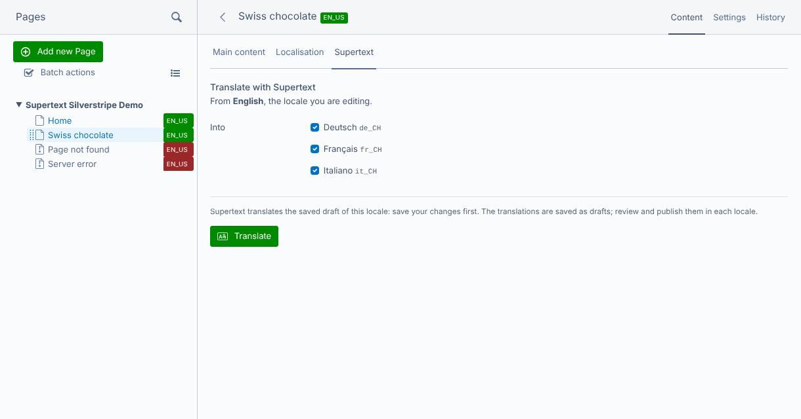
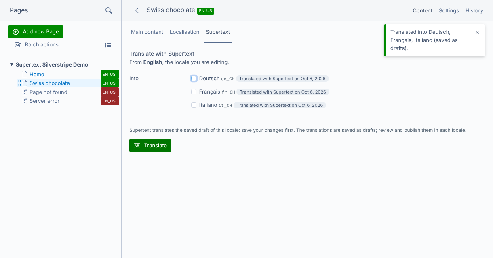
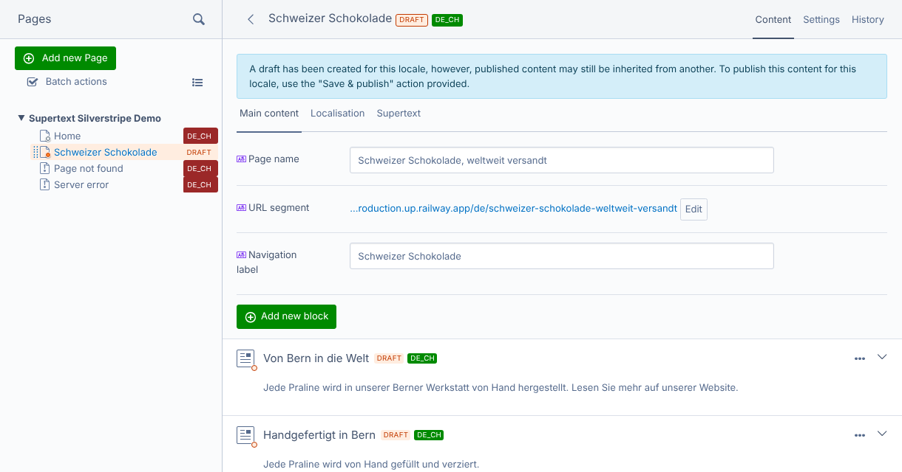
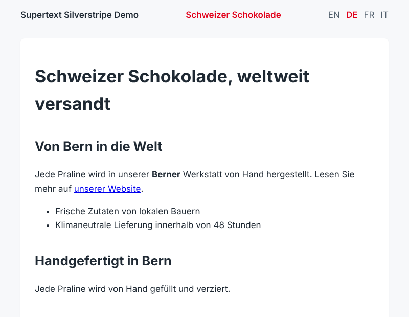
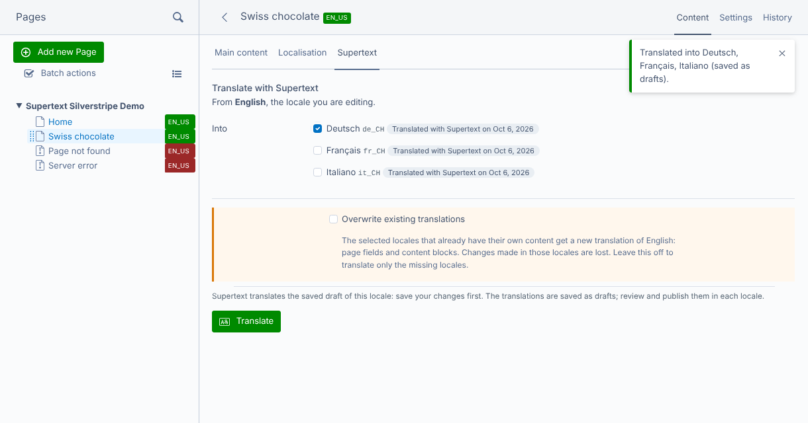

# User guide — Supertext Translation for Silverstripe

For editors who translate pages in the Silverstripe CMS. Your administrator has installed the module and set up the locales (see the [installation guide](INSTALLATION.md)).

The Supertext tab and its messages appear in your CMS interface language (English, German, French or Italian).

## Translate a page

1. In **Pages**, choose the locale you translate **from** with the locale switcher at the top of the CMS menu (usually English), and open the page.
2. Save your changes first. Supertext translates the saved draft.
3. Open the **Supertext** tab.
4. Under **Into**, tick the locales to create. Locales where the page doesn't exist yet are ticked. A greyed-out locale marked **No Supertext language** can't be translated yet: your administrator needs to choose its Supertext language under *Locales* → the locale (most locales have a default; only ones like `en_IE` or `gsw` need it).
5. Click **Translate**.

Each locale takes a few seconds. A message then reports the result, and each locale shows **Translated with Supertext on** *date*:

## Review and publish

Switch to the locale (locale switcher) and open the page. The translation is a **draft** in that locale: the page name, navigation label, meta description, URL segment and all content blocks are translated, and formatting such as bold text, links and lists stays in place.

Change what you like, as if you had translated by hand, then **Publish**. Until you publish, visitors still see the content Fluent shows for that locale (usually the English fallback).

## Translate again or update a translation

Locales the page already exists in show **Already translated** or **Translated with Supertext on** *date*, and are not ticked. If you tick one, the tab shows an extra option:

- Leave **Overwrite existing translations** off: those locales are skipped (*Already translated, skipped*); only missing locales are created. Your edits are safe.
- Turn it on: the page fields and content blocks of those locales get a new translation of the locale you are in. **Changes made in those locales are lost.** The URL segment of an existing locale stays as it is. The result is again a draft; the published version stays online until you publish.

You can translate from any locale the page has its own content in, e.g. from German into French, by switching to that locale first.

## Export for translation and import the translated file

Instead of translating with Supertext straight away, you can download a page's texts as a file, have it translated elsewhere (a translation tool such as Trados, memoQ or Phrase, a translator, or Supertext's web app) and import the translated file again. Both are at the bottom of the **Supertext** tab. The file holds exactly the texts **Translate** would send: page fields and content blocks, in the locale you are editing.

**Export for translation:**

1. Open the page in the locale you want to translate from and go to the **Supertext** tab.
2. Choose the **File format**:
   - **XLIFF 1.2 (for translation tools)**: the better choice for translation tools and translators. Formatting (bold, links, lists) is shown as protected tags, so it can be moved but not broken. One file can hold several locales.
   - **HTML (one language per file)**: for Supertext's web app or anyone who translates HTML files. Tick exactly one locale.
3. Tick the locales under **Into** (locales without a Supertext language can be exported too) and click **Download file**. The file is called e.g. `silverstripe-12-de_CH.xlf` (`silverstripe-12.xlf` with several locales; `.html` for HTML).

Send the file to your translator, or upload it to Supertext's web app. Whoever translates an **HTML** file must leave its `<head>` and the `data-st-id` attributes alone: the module needs them to find the page and the texts again. An HTML file can't mark a text as untranslated, so an HTML file imported unchanged writes the original (source) text into the translation.

**Import translation:**

1. On the **Supertext** tab of any page (the file says which page and locale it belongs to), choose the **Translated file (XLIFF or HTML)**, at most 10 MB.
2. Tick **Also import texts whose source changed since the export** only if texts edited in the original after the export should be imported anyway (their translation may no longer fit). Off by default.
3. Tick **Overwrite existing translations** if the page already has its own content in that locale and you want to replace it; otherwise that locale is skipped.
4. Click **Import translation**. The translations are saved as a **draft** in their locale, like translations made with Supertext; review and publish them there. A locale the page already has keeps the texts the file doesn't translate.

The summary shows, per locale:

| Line | Meaning |
| --- | --- |
| *Imported: N* | Texts written into the draft. |
| *Skipped, source changed since the export: N* | The original text was edited after the export. Import again with *Also import texts whose source changed since the export*, or export again. |
| *Not translated in the file: N* | The file has no translation for these texts (e.g. left empty in the translation tool). |
| *Formatting changed, not imported: N* | The translation broke or added formatting (tags) the original doesn't have. Fix it in the file and import again. |
| *Not in the file: N* | Texts added to the page since the export. Export again to translate them. |

## What is translated

| Content | What happens |
| --- | --- |
| Page name, navigation label, meta description | Translated |
| URL segment | Made from the translated page name when a locale is created; kept when overwriting |
| Content (HTML editor) | Translated as HTML: headings, bold, italic, links and lists stay in place, link addresses are kept |
| Content blocks (Elemental) | Their titles and texts are translated, if blocks are localised (ask your administrator) |
| Other text fields of the page type | Translated if they are localised, unless your administrator excluded them |
| Images, files, settings (e.g. who can view the page) | Not translated |

Empty fields are skipped.

## The translation log

**Supertext** in the CMS menu lists every translation: page, locales, result, who started it and when.

## Messages

| Message | Meaning |
| --- | --- |
| *Supertext is not set up yet: …* | No API key on the server. Ask your administrator. |
| *Already translated, skipped: …* | Those locales exist and *Overwrite existing translations* was off. |
| *This page has no content of its own in … yet* | Switch to a locale the page was written in. |
| *You are not allowed to edit this page in …* | You may not edit that locale. Ask your administrator. |
| *Choose at least one locale to translate into.* | Tick at least one locale under *Into*. |
| *Authentication failed. Please check the Supertext API key.* | The API key is wrong. Ask your administrator. |
| *Your Supertext translation limit is exceeded.* | Your organisation's Supertext limit is used up. |
| *The language … has no Supertext language yet.* | Your administrator hasn't told the module which Supertext language to use for that locale. Ask them to map it; the other locales are translated. |
| *Supertext does not support this language pair (en → …).* | Supertext can't translate into this locale, or its Supertext language is wrong. Tell your administrator. |
| *Supertext offers no formal or informal tone for this language.* | The locale's form of address can't be used with Supertext; ask your administrator to set it to *Default*. |
| *Too many requests to Supertext. Please try again shortly.* | Supertext was busy; try again in a moment. |
| *This file isn't a valid XLIFF or HTML translation file.* (import) | Not an XLIFF or HTML file, or damaged. |
| *This file wasn't exported by the Supertext module, or its header was removed.* (import) | The file has no Supertext information (e.g. an HTML file whose `<head>` was removed). |
| *The file is too large (at most 10 MB).* (import) | Split the work into smaller files. |
| *This file belongs to another system (…).* (import) | The file was exported by a Supertext plugin for another CMS. |
| *The page this file was exported from no longer exists.* (import) | The original page was deleted. |
| *The site has no locale ….* (export, import) | The locale was removed (or is the locale you export from). |
| *Nothing to translate.* (export) | The page has no text to translate in this locale. |
| *Timed out waiting for the Supertext translation.* / *The Supertext service is currently unavailable.* | Supertext took too long or is unavailable. Try again later. |

Errors are reported per locale: if one locale fails, the others are still translated.
